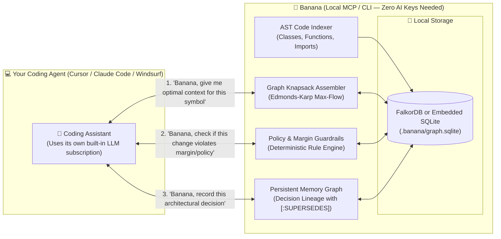

<div align="center">

# 🍌 Banana

### Autonomous Graph Memory & Context Brain for AI Coding Agents

[](https://python.org)
[](https://modelcontextprotocol.io)
[](https://falkordb.com)
[](https://pytest.org)
[](#-zero-ai-keys--zero-docker-architecture)
[](LICENSE)

*Banana supercharges your existing coding agent (**Cursor**, **Claude Code**, **Windsurf**, or **VS Code**) with photographic cross-session memory, codebase AST dependency graphs, and deterministic policy guardrails — with **Zero AI Keys** and **Zero Docker Setup**.*

---

[How It Works](#-how-it-works-with-your-coding-agent) •
[Quickstart](#-quickstart-for-cursor--claude-code) •
[Capabilities](#-core-capabilities) •
[Benchmarks](#-scientific-benchmarks) •
[CLI Reference](#-cli-command-reference)

</div>

---

## ⚡ Why Your Coding Agent Needs Banana

AI coding assistants (Claude Code, Cursor, Copilot) are brilliant at writing syntax, but suffer from three fundamental limitations:
1. **Session Amnesia:** When you start a new task tomorrow, the agent forgets why architectural decisions were made, reverts past refactors, or reinvents patterns.
2. **Context Window Bloat:** Reading 30+ files burns 50,000+ tokens per prompt and triggers attention loss ("lost in the middle").
3. **Missing Guardrails:** Coding agents cave under customer or prompt pressure, proposing below-margin discounts or introducing layer violations (e.g. database imports in UI code).

### **The Banana Solution**
Banana acts as the **local graph memory and context engine** for your agent:



---

## 🔒 Zero AI Keys & Zero Docker Architecture

- **No AI Key Required:** Banana does not call external LLM APIs. Your existing coding agent (Cursor / Claude Code) uses its own built-in model to do all generative thinking.
- **No Docker Required:** Banana automatically uses FalkorDB if running, or seamlessly falls back to a **zero-dependency embedded SQLite graph** (`.banana/graph.sqlite`).
- **100% Private & Local:** All codebase graphs, memory nodes, and policy rules live entirely on your machine.

---

## 🚀 Quickstart for Cursor & Claude Code

### 1. Connect with Claude Code
```bash
claude mcp add banana -- uv run banana mcp
```

### 2. Connect with Cursor (`.cursor/mcp.json`)
```json
{
  "mcpServers": {
    "banana": {
      "command": "uv",
      "args": ["run", "banana", "mcp"]
    }
  }
}
```

### 3. Verify Local Installation
```bash
uv run banana doctor
```

---

## 🌟 Core Capabilities

### 1. 🧠 Photographic Cross-Session Memory
- When your coding agent completes a refactor or architectural shift, it calls `banana_save_decision`:
  ```python
  banana_save_decision(
      title="Adopt Pydantic v2 schemas",
      finding="Always use .model_dump() instead of .dict() across models",
      supersedes_id="pydantic_v1_decision"
  )
  ```
- In tomorrow's session, the agent queries `banana_query_decisions` and automatically abides by all past architectural agreements.

### 2. ⚡ High-Signal Code Context Knapsack
- Instead of dumping entire files into context, the agent calls `banana_assemble_code_context(query="auth", token_budget=1500)`.
- Banana traverses the codebase AST graph and returns only the prerequisite class interfaces, function signatures, and docstrings under a strict token budget knapsack.

### 3. 🛑 Deterministic Policy & Architecture Guardrails
- **Margin Floor Governance:** Intercepts proposed prices that violate minimum gross margin policies ($\ge 25\%$) before words are spoken.
- **Architectural Layer Boundary Rules:** Prevents presentation layers (`views/app.py`) from directly importing low-level database engines.
- **Sub-Millisecond Speed:** All rule evaluations run deterministically in Python in **< 2ms without burning a single LLM token**.

### 4. 📁 Local AST Codebase Indexing
- Scans and maps your repository structure into graph nodes:
  - `(:File)-[:IMPORTS]->(:File)`
  - `(:Class)-[:DEFINES]->(:Function)`
  - `(:Function)-[:CALLS]->(:Function)`
- Run via terminal or let your coding agent index on demand via `banana_index_codebase()`.

---

## 📊 Scientific Benchmarks

Head-to-head evaluation against industry baselines across identical tasks and token constraints:

| Strategy | Budget (Tokens) | Assembled Tokens | Policy Preservation | Subgraph Dependency Integrity | Evidence Coverage | Latency |
| :--- | :---: | :---: | :---: | :---: | :---: | :---: |
| **Baseline A (Naive Truncation)** | 1,100 | 890 | 25.0% ⚠️ | 100.0% | 83.3% | ~4ms |
| **Baseline B (Relevance Top-K)** | 1,100 | 886 | 100.0% | 75.0% ⚠️ | 50.0% | ~0.2ms |
| **🍌 Banana (Graph-Aware Knapsack)** | **1,100** | **698** | **100.0% ✅** | **100.0% ✅** | **50.0%** | **~5ms** |
| Baseline A (Naive Truncation) | 1,600 | 1,285 | 87.5% ⚠️ | 100.0% | 100.0% | ~4ms |
| Baseline B (Relevance Top-K) | 1,600 | 1,298 | 100.0% | 75.0% ⚠️ | 83.3% | ~0.2ms |
| **🍌 Banana (Graph-Aware Knapsack)** | **1,600** | **1,030** | **100.0% ✅** | **100.0% ✅** | **83.3%** | **~5ms** |

> [!IMPORTANT]
> **Key Benchmark Takeaways:**
> - **Naive Truncation** loses up to **75% of mandatory security & margin policies** under tight budgets due to arbitrary cut-offs.
> - **Relevance Top-K** drops **25% of prerequisite dependency edges**, selecting claims without their required definitions.
> - **Banana** guarantees **100% Policy Preservation** and **100% Dependency Integrity** with sub-6ms graph traversal overhead.

---

## 💻 CLI Command Reference

| Command | Description |
| :--- | :--- |
| `uv run banana mcp` | Launch the stdio Model Context Protocol (MCP) server for Cursor / Claude Code. |
| `uv run banana index [path]` | Scan and index local codebase AST (classes, functions, imports) into the repository graph. |
| `uv run banana code-context "<query>"` | Assemble high-signal code context (signatures, interfaces) under a token knapsack. |
| `uv run banana guardrails --price <N>` | Test pricing proposals against gross margin floors in real time. |
| `uv run banana decision list` | View all persistent cross-session architectural decisions in local memory. |
| `uv run banana decision save --title ...` | Record a new architectural decision or lesson learned with `[:SUPERSEDES]` lineage. |
| `uv run banana doctor` | Verify system health, tokenizers, and database / embedded storage readiness. |
| `uv run banana benchmark` | Run head-to-head scientific benchmark against naive truncation and relevance top-K. |

---

## 🧪 Testing

Run the automated test suite:
```bash
uv run pytest
```
```
============================== 36 passed in 19.4s ==============================
```
Covers coding agent tools, codebase AST indexing, guardrails validation, embedded SQLite graph engine, Edmonds-Karp load shedding, and cross-session decision persistence.

---

## 📄 License

MIT © 2026 Banana Project Contributors.
