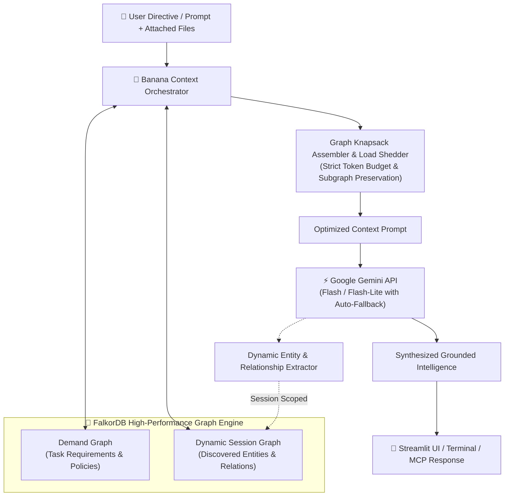

<div align="center">

# 🍌 Banana

### Graph-Aware Context Orchestration Agent & Dynamic Knowledge Engine

[](https://python.org)
[](https://falkordb.com)
[](https://ai.google.dev)
[](https://pytest.org)
[](LICENSE)

*Banana eliminates vector RAG hallucinations and context bloat by orchestrating LLM context as a graph-matching problem under constrained token knapsacks, backed by FalkorDB dynamic session graphs and Google Gemini.*

---

[Key Capabilities](#-key-capabilities) •
[Architecture](#-architecture) •
[Quickstart](#-quickstart) •
[Benchmarks](#-scientific-benchmarks) •
[MCP Integration](#-mcp-server-for-coding-agents) •
[CLI Reference](#-cli-command-reference)

</div>

---

## ⚡ The Problem: Why Flat Vector RAG Fails

Standard retrieval-augmented generation (RAG) relies on flat cosine similarity top-$K$ search:
- **Orphaned Chunk Flaw:** Retrieves a metric or discount without its prerequisite governance policies, SLA clauses, or definitions, causing policy breaches or hallucinations.
- **Context Bloat Flaw:** Stuffing 100k+ tokens into prompts triggers attention decay ("lost in the middle"), multiplies latency, and burns cloud budgets.

### **The Banana Solution**
Banana replaces naive chunk retrieval with **graph-aware context assembly** and **progressive load shedding**:
1. **Demand Graph (`banana_demand`):** Formulates what a task strictly requires (entities, security policies, tool definitions, evidence).
2. **Knowledge Graph (`banana_knowledge`):** Models multi-turn session concepts, document facts, competitor metrics, and past decisions.
3. **Graph-Matching Knapsack:** Assembles context using priority tiers (P0: Mandatory Governance ➔ P4: Background) while strictly preserving dependency subgraphs and staying under token limits.

---

## 🏗️ Architecture



---

## 🌟 Key Capabilities

### 1. 💬 Multipurpose Domain Research (Tab 1)
- **Genuine Google Gemini Inference:** Direct live synthesis with automatic fallback across `gemini-3.8-flash`, `gemini-3.5-flash-lite`, and latest models to guarantee 100% uptime under free-tier quota limits.
- **Native Integrated Document Upload:** Drag-and-drop PDFs, text files, CSVs, markdown, and screenshots directly inside `st.chat_input` (`📎`).
- **Multimodal Vision:** Automatically parses charts and invoices using Gemini Vision and inserts findings directly into the conversation.
- **Multi-Turn Continuity:** Full conversational recall within each session, while keeping different sessions strictly isolated.

### 2. 🧠 Dynamic Session Knowledge Graph (Tab 2)
- **Zero Mock Data:** Graphs are generated 100% dynamically from user research, ingested files, and agent reasoning.
- **Full-Page Interactive D3.js Network:** Explore discovered nodes, entity types, and relationship edges visually.
- **Entity & Relationship Catalog:** Searchable tabular view of all extracted graph elements with real-time session clear/reset.

### 3. 🎙️ Google Meet Sentinel (Tab 3)
- **Zero-Token Idle Companion:** Minimal terminal companion (`uv run banana meet`) for sales and engineering calls.
- **No Browser Extensions or Bots:** Runs natively in your terminal alongside Google Meet or Zoom.
- **Real-Time Policy Governance:** Intercepts rogue discounts below gross margin floors (e.g., 25% mandatory margin) before commitments are spoken.
- **Competitor Hidden Cost Exposure:** Instantly flags competitor pricing traps (e.g., CloudScale's $0.08/GB egress fees turning an $800 sticker price into $1,936/mo).
- **Auto-Log Commitments:** Automatically captures verbal terms, assignees, and deadlines into FalkorDB memory.

---

## 🚀 Quickstart

### Prerequisites
- Python 3.12+
- Docker & Docker Compose
- [uv package manager](https://astral.sh/uv)

### 1. Start FalkorDB Container
```bash
docker run -d --name banana-falkordb -p 6379:6379 falkordb/falkordb:latest
```

### 2. Configure Environment
Create a `.env` file in the project root:
```ini
FALKORDB_HOST=localhost
FALKORDB_PORT=6379
GEMINI_API_KEY=your_gemini_api_key_here
GEMINI_MODEL=gemini-3.8-flash
DEFAULT_TOKEN_BUDGET=4000
```

### 3. Verify System Health
Run Banana Doctor to verify Python, database connectivity, and Gemini API inference:
```bash
uv run banana doctor
```

### 4. Launch Streamlit Web UI
```bash
uv run banana ui
```
Open [http://localhost:8501](http://localhost:8501) in your browser.

---

## 📊 Scientific Benchmarks

Head-to-head evaluation against industry baselines across identical tasks and token constraints:

| Strategy | Budget (Tokens) | Assembled Tokens | Policy Preservation | Subgraph Dependency Integrity | Evidence Coverage | Latency |
| :--- | :---: | :---: | :---: | :---: | :---: | :---: |
| **Baseline A (Naive Truncation)** | 1,100 | 890 | 25.0% ⚠️ | 100.0% | 83.3% | ~4ms |
| **Baseline B (Relevance Top-K)** | 1,100 | 886 | 100.0% | 75.0% ⚠️ | 50.0% | ~0.2ms |
| **🍌 Banana (Graph-Aware Knapsack)** | **1,100** | **698** | **100.0% ✅** | **100.0% ✅** | **50.0%** | **~5ms** |
| Baseline A (Naive Truncation) | 1,600 | 1,285 | 87.5% ⚠️ | 100.0% | 100.0% | ~4ms |
| Baseline B (Relevance Top-K) | 1,600 | 1,298 | 100.0% | 75.0% ⚠️ | 83.3% | ~0.2ms |
| **🍌 Banana (Graph-Aware Knapsack)** | **1,600** | **1,030** | **100.0% ✅** | **100.0% ✅** | **83.3%** | **~5ms** |

> [!IMPORTANT]
> **Key Benchmark Takeaways:**
> - **Naive Truncation** loses up to **75% of mandatory security & margin policies** under constrained budgets due to arbitrary cut-offs.
> - **Relevance Top-K** drops **25% of prerequisite dependency edges**, selecting factual claims without their required definitions.
> - **Banana** guarantees **100% Policy Preservation** and **100% Dependency Integrity** with sub-6ms graph traversal overhead.

---

## 🔌 MCP Server for Coding Agents

Banana provides a full [Model Context Protocol (MCP)](https://modelcontextprotocol.io/) server, allowing external coding assistants (**Claude Code**, **Cursor**, **Windsurf**, **Google Antigravity**) to leverage Banana's graph-aware context engine.

### Connect with Claude Code
```bash
claude mcp add banana -- uv run banana mcp
```

### Connect with Cursor / Antigravity
Add to your `mcp.json` configuration:
```json
{
  "mcpServers": {
    "banana": {
      "command": "uv",
      "args": ["run", "banana", "mcp"]
    }
  }
}
```

### Exposed MCP Tools
- `banana_orchestrate_context(prompt, token_budget)`: Graph-assembled context with load-shedding.
- `banana_query_knowledge(query_or_cypher)`: Query dynamic session graphs in FalkorDB.
- `banana_simulate_sandbox(cloudscale_discount_pct, cogs_inflation_pct)`: Ephemeral what-if simulation.
- `banana_save_decision(title, finding, supersedes_id)`: Logs versioned decisions with lineage.
- `banana_ingest_document(file_path)`: Multimodal document extraction and graph indexing.

---

## 💻 CLI Command Reference

| Command | Description |
| :--- | :--- |
| `uv run banana doctor` | System diagnostic verifying Python, FalkorDB, tokenizers, and Gemini API. |
| `uv run banana ui` | Launch the clean Streamlit Web Dashboard on port 8501. |
| `uv run banana meet` | Launch the live interactive Google Meet terminal companion. |
| `uv run banana meet --auto` | Run 30-second automated companion demo of live margin and fee defense. |
| `uv run banana run "<prompt>"` | Execute standalone graph-aware agent query in terminal. |
| `uv run banana benchmark` | Run head-to-head benchmark against naive truncation and relevance top-K. |
| `uv run banana ingest <file>` | Multimodal ingestion of PDFs, images, or invoices via Gemini Vision. |
| `uv run banana inspect-graph` | Visual terminal inspection of FalkorDB graph nodes and relationships. |
| `uv run banana mcp` | Start stdio Model Context Protocol (MCP) server. |

---

## 🧪 Testing

Run the full automated test suite:
```bash
uv run pytest
```
```
============================== 32 passed in 13.2s ==============================
```
Covers agent execution, FalkorDB dual graph operations, knapsack load shedding, context assembly, multi-turn memory isolation, multimodal ingestion, and benchmark baselines.

---

## 📄 License

MIT © 2026 Banana Project Contributors.
